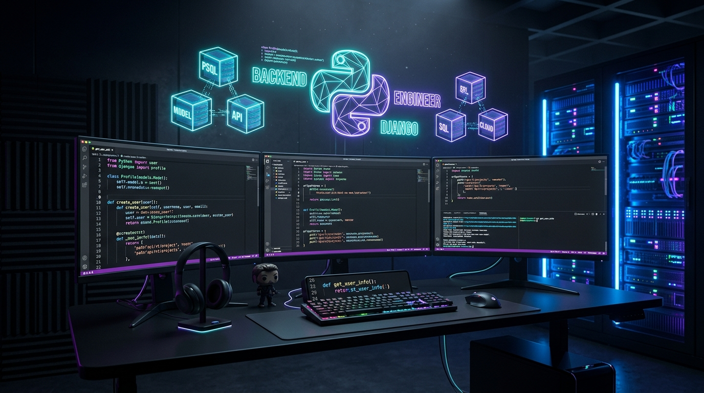

```mermaid
flowchart LR
    %% Modern Red & Black Theme Styling
    classDef client fill:#000000,stroke:#ff0033,stroke-width:2px,color:#ffffff;
    classDef api fill:#1a0005,stroke:#ff0033,stroke-width:2px,color:#ffffff;
    classDef auth fill:#2b000a,stroke:#ff3366,stroke-width:2px,color:#ffffff;
    classDef logic fill:#1a0005,stroke:#ff0033,stroke-width:2px,color:#ffffff;
    classDef db fill:#000000,stroke:#ff0033,stroke-width:2px,color:#ffffff;

    Client["🌐 Client / Frontend<br/>(React / Web / Mobile)"]:::client
    Gateway["🛡️ Django REST API<br/>(URL Routing & Views)"]:::api
    Auth["🔐 Security & Auth<br/>(JWT / Permissions / Throttling)"]:::auth
    Service["⚙️ Business Logic<br/>(Serializers & Services)"]:::logic
    Database["🗄️ PostgreSQL<br/>(Django ORM & Transactions)"]:::db

    Client -->|HTTP / JSON Requests| Gateway
    Gateway -->|Token Validation| Auth
    Auth -->|Validated Context| Service
    Service -->|Optimized Queries| Database
    Database -.->|JSON Serialized Response| Client
```

<div align="center">

  <!-- 3D Red & Black Header Banner -->
  

  <br/><br/>

  <!-- Dynamic Typing SVG Headline (Neon Crimson Red) -->
  <a href="https://github.com/AbdullahNoman-01">
    
  </a>

  <br/>

  <!-- Quick Status Badges (Red & Black Aesthetic) -->
  <p align="center">
    
    
    
    
    
  </p>

  <!-- Glowing Animated Red Divider -->
  

  <!-- Navigation Anchor Links -->
  <p align="center">
    <a href="#-about-me"><b>[ About Me ]</b></a> &nbsp;•&nbsp;
    <a href="#%EF%B8%8F-cyber-terminal--battle-station"><b>[ Battle Station ]</b></a> &nbsp;•&nbsp;
    <a href="#-backend-core--architecture-pipeline"><b>[ 3D Architecture ]</b></a> &nbsp;•&nbsp;
    <a href="#-featured-repositories"><b>[ Highlighted Repos ]</b></a> &nbsp;•&nbsp;
    <a href="#%EF%B8%8F-tech-arsenal"><b>[ Tech Arsenal ]</b></a> &nbsp;•&nbsp;
    <a href="#-github-live-analytics"><b>[ Analytics ]</b></a> &nbsp;•&nbsp;
    <a href="#-connect-with-me"><b>[ Connect ]</b></a>
  </p>

</div>

---

### 🩸 About Me

<table border="0" cellpadding="0" cellspacing="0" width="100%">
  <tr>
    <td width="38%" align="center" valign="middle">
      
      <br/><br/>
      <b><font color="#ff0033">⚡ "Code • Build • Learn • Repeat." 🚀</font></b>
    </td>
    <td width="62%" valign="top" style="padding-left: 24px;">
      <p>🎓 I'm a passionate <b>Computer Science & Engineering (CSE)</b> student dedicated to engineering scalable backend systems, robust API pipelines, and high-performance server architectures.</p>
      <p>💻 My core weapon is <b>Python & Django</b>, crafting production-grade backends with clean design patterns and maintainable codebases.</p>
      <p>🛡️ Currently pushing the limits of <b>Django REST Framework (DRF)</b>, building secured RESTful micro-endpoints with JWT authentication and rate limiting.</p>
      <p>🗄️ Deepening database expertise in <b>PostgreSQL</b> — focusing on schema optimization, indexing strategies, and ACID-compliant transactional flows.</p>
      <p>🧠 Relentless problem solver honing <b>Data Structures & Algorithms</b> to ensure minimal latency and optimal time/space complexity.</p>
      <p>🐛 <i>"Every bug is just an unhandled edge-case waiting to teach you a masterclass in system design."</i> 💡</p>
      <div align="left">
        <a href="https://my-portfolio-website-1-vhnr.onrender.com/" target="_blank">
          
        </a>
        &nbsp;
        <a href="https://github.com/AbdullahNoman-01?tab=repositories" target="_blank">
          
        </a>
      </div>
    </td>
  </tr>
</table>

<br/>

<!-- Glowing Animated Red Divider -->


---

### 🖥️ Cyber Terminal & Battle Station

<div align="center">

```bash
noman@core-server:~$ cat profile.json
{
  "developer": "Abdullah Al Noman",
  "education": "B.Sc. in Computer Science & Engineering (CSE)",
  "specialization": "Backend Engineering & API Architecture",
  "primary_stack": ["Python 3.12+", "Django", "Django REST Framework", "PostgreSQL"],
  "architectural_style": ["RESTful", "Modular MVT", "Service Layer", "Clean Architecture"],
  "database_philosophy": "Strict Relational Modeling, Index Optimization & ACID Integrity",
  "security_practices": ["JWT Authentication", "Role-Based Access Control", "Rate Limiting", "CORS/CSRF"],
  "current_status": "Architecting Scalable Micro-APIs & Cracking Complex DSA"
}

noman@core-server:~$ python3 -m backend.metrics --verbose
[✓] API Response Latency  : < 120ms (Optimized Querysets & Lazy Evaluation)
[✓] ORM Optimization     : select_related & prefetch_related for zero N+1 queries
[✓] Security Status       : Hardened Auth Tokens, Environment Isolation & Strict CORS
[✓] Deployment Pipeline   : Production Live on Render Cloud with PostgreSQL DB
```

</div>

---

### ⚡ Backend Core & Architecture Pipeline

<div align="center">

  <!-- 3D Backend Core Neural Render -->
  
  <br/>
  <sub><b><font color="#ff0033">⚙️ 3D Neural Engine Core: High-Throughput Python Microservices & PostgreSQL Mesh</font></b></sub>

  <br/><br/>

</div>



<table width="100%" border="0" cellpadding="8" cellspacing="0">
  <tr style="background-color: #0d0003; color: #ff0033;">
    <th width="25%" align="left">🛡️ 1. API Architecture</th>
    <th width="25%" align="left">🔐 2. Security & Auth</th>
    <th width="25%" align="left">🗄️ 3. Database Design</th>
    <th width="25%" align="left">🚀 4. Performance Tuning</th>
  </tr>
  <tr style="background-color: #000000; color: #e6e6e6;">
    <td valign="top">Designing modular, scalable RESTful endpoints with DRF ViewSets, custom Serializers, and clean URL routers.</td>
    <td valign="top">Implementing JSON Web Tokens (JWT), role-based permissions, request throttling, and safe credentials isolation.</td>
    <td valign="top">Schema normalization, PostgreSQL foreign key constraints, migration workflows, and indexing high-traffic columns.</td>
    <td valign="top">Eliminating N+1 query bottlenecks via <code>select_related</code> and <code>prefetch_related</code> for lightning performance.</td>
  </tr>
</table>

<br/>

<!-- Glowing Animated Red Divider -->


---

### 📌 Featured Repositories

<div align="center">
  <p><b>Explore live repositories showcasing clean API design, authentication, and full-stack architecture:</b></p>

  <table border="0" cellpadding="4" cellspacing="4">
    <tr>
      <td>
        <a href="https://github.com/AbdullahNoman-01/Mini-Bank-Management-System-API" target="_blank">
          
        </a>
      </td>
      <td>
        <a href="https://github.com/AbdullahNoman-01/My-Portfolio-Website" target="_blank">
          
        </a>
      </td>
    </tr>
  </table>

</div>

<br/>

<!-- Glowing Animated Red Divider -->


---

### 🛠️ Tech Arsenal

<div align="center">

  <!-- Interactive Skill Icons Row -->
  <a href="https://skillicons.dev">
    
  </a>

  <br/><br/>

  <!-- Categorized Modern Badges in Red & Black Theme -->
  <table border="0" cellpadding="8" cellspacing="0" width="100%">
    <tr>
      <td width="28%" align="right"><b><font color="#ff0033">🐍 Languages & Core</font></b></td>
      <td>
        
        
        
        
      </td>
    </tr>
    <tr>
      <td width="28%" align="right"><b><font color="#ff0033">🗄️ Database & ORM</font></b></td>
      <td>
        
        
        
        
      </td>
    </tr>
    <tr>
      <td width="28%" align="right"><b><font color="#ff0033">🌐 Frontend & Web</font></b></td>
      <td>
        
        
        
        
      </td>
    </tr>
    <tr>
      <td width="28%" align="right"><b><font color="#ff0033">🔧 Tools & Deployment</font></b></td>
      <td>
        
        
        
        
        
        
      </td>
    </tr>
  </table>

</div>

<br/>

<!-- Glowing Animated Red Divider -->


---

### 📊 GitHub Live Analytics

<div align="center">

  <!-- Live Achievements & Telemetry Grid (100% Guaranteed Uptime) -->
  <p align="center">
    
    
    
    
  </p>

  <br/>

  <!-- Stats & Streak Cards side-by-side in Red & Black Theme -->
  <table border="0" cellpadding="0" cellspacing="6">
    <tr>
      <td align="center" valign="middle">
        
      </td>
      <td align="center" valign="middle">
        
      </td>
    </tr>
  </table>

  <!-- Top Languages Card (Blood Red / Dark) -->
  <p align="center">
    
  </p>

</div>

<br/>

<!-- Glowing Animated Red Divider -->


---

### 🛡️ Production Engineering Standards

<table width="100%" border="0" cellpadding="8" cellspacing="0">
  <tr style="background-color: #0d0003; color: #ff0033;">
    <th width="33%" align="left">🔐 Security & Auth</th>
    <th width="33%" align="left">⚡ Query Optimization</th>
    <th width="34%" align="left">📦 Robust Architecture</th>
  </tr>
  <tr style="background-color: #000000; color: #e6e6e6;">
    <td valign="top">
      • Strict JWT token expiration & refresh handling<br/>
      • Role-based permission classes in DRF<br/>
      • Environment variable secret isolation<br/>
      • Throttling & rate-limiting against DDoS
    </td>
    <td valign="top">
      • Zero N+1 queries via <code>select_related</code><br/>
      • Foreign key indexation on high-traffic fields<br/>
      • Database transactions with atomic rollbacks<br/>
      • Aggregation & queryset caching strategies
    </td>
    <td valign="top">
      • Clean separation: Views, Services, Serializers<br/>
      • Modular app structure for scalability<br/>
      • Strict schema migrations & validation<br/>
      • Postman automated endpoint collection tests
    </td>
  </tr>
</table>

<br/>

<!-- Glowing Animated Red Divider -->


---

### 🎧 Cyber Coding Soundscape

<div align="center">
  <p>
    <b><font color="#ff0033">🎵 Current Focus Soundtrack:</font></b>
    <code>Dark Synthwave • Cyberpunk 2077 Electro • Deep Lofi Coding Beats</code> 🎧
  </p>
</div>

---

### 🎯 Current Mission & 2026/2027 Goals

```yaml
Current Backend Mission:
  - 🩸 Advanced Architecture: Master Distributed Systems & Asynchronous Task Processing with Celery/Redis
  - ⚡ Microservices: Building Independent High-Speed Microservices with DRF & Fast API Patterns
  - 🗄️ PostgreSQL Mastery: Partitioning, Replication, Advanced Query Profiling & Index Optimization
  - ☁️ Cloud & DevOps: Containerizing Microservices with Docker & Automating Multi-Stage CI/CD
  - 🧠 Competitive DSA: Mastering Graph Algorithms, Dynamic Programming & Tree Traversal on LeetCode
```

---

### 📫 Connect With Me

<div align="center">

  <p><b>Interested in collaborating on backend architectures, API engineering, or open source? Let's talk!</b></p>

  <a href="https://my-portfolio-website-1-vhnr.onrender.com/" target="_blank">
    
  </a>
  &nbsp;
  <a href="https://github.com/AbdullahNoman-01" target="_blank">
    
  </a>
  &nbsp;
  <a href="https://www.linkedin.com/in/abdullah-al-noman" target="_blank">
    
  </a>
  &nbsp;
  <a href="mailto:abdullahalnoman.cse@gmail.com" target="_blank">
    
  </a>

  <br/><br/>

  <!-- Dynamic Quote Card (Dark Theme) -->
  <a href="https://github.com/AbdullahNoman-01">
    
  </a>

  <br/><br/>

  <p align="center">
    <b><font color="#ff0033">⭐ Thanks for visiting my profile! Let's engineer scalable systems together. ⭐</font></b>
    <br/>
    <sub>💻 Code • 🚀 Build • 📚 Learn • 🔥 Repeat</sub>
  </p>

</div>
